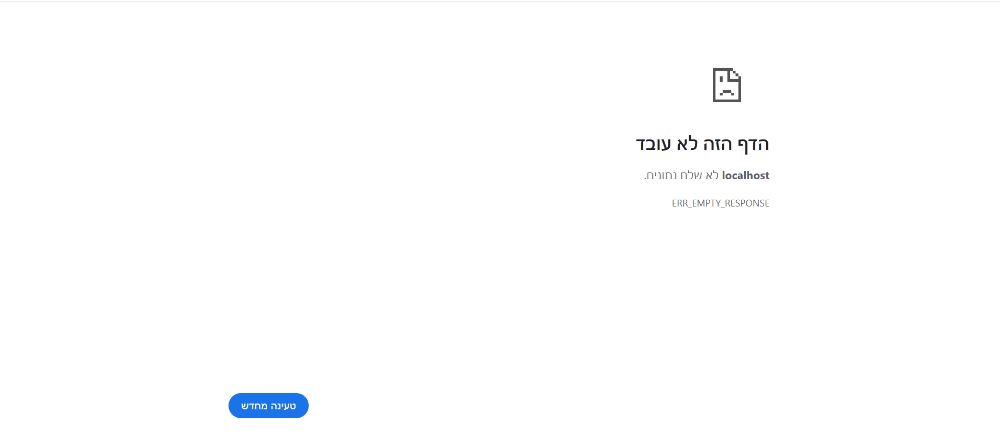

# Advanced-Programming
# Program - Workflow
## FMS (File Management Server)
### Program starts in Main.cpp ###
#### <br>Main:  ####
Creates a Matchmaker object that is responsible for most of the arrangements. 
#### Matchmaker: ####
Creates a Server.
Accepts Clients and for each one creates:<br>
-- App<br>
-- Commands<br>
-- Validators<br>
Then starts a thread and waits for the next Client.
#### Validators:  ####
PostValidator, GetValidator, SearchValidator, DeleteValidator (all implement IValidator)
#### Commands:  ####
PostCommand, GetCommand, SearchCommand, DeleteCommand.  
Each command gets a reference to the encoder and its validator.  
A map<string, tuple<ICommand*, bool>> that connects command names ("post", "get", "search", "delete") to the corresponding ICommand objects and the requires Muting boolean.  
Builds an App object with the menu + command map + common mutex + default-output string.  
Calls app.run().  
#### App::run() – main loop ####  
Runs forever in a while(true) loop.  
#### On each iteration:  ####
Asks the menu for the next line of input:  
string line = menu->nextCommand();  
#### Splits the line into:  ####
cmd → the first word (e.g. "post")  
<br>args → the rest of the line (e.g. "file1 some text")  
#### Looks up cmd in the commands map:  ####
If command does not exist → input is ignored (no output).  
Calls command->execute(args) on the matching ICommand.  
Takes the returned string result and passes it to the menu:  
menu->printOutput(result);  
Then the loop repeats and waits for the next user input.  
#### Each command validates + executes its logic  ####
At the start of every execute():  
The command calls its validator:  
auto* parsed = validator.validate(args);  
If the validator returns nullptr → the input is invalid → the command returns an appropriate string and does nothing.  
If the validator returns a non-null pointer → input is valid, and the command continues with its logic (and frees the parsed list when done).
#### Post Command (`post <filename> <text>`)  ####
➤ Validates that both a filename and text are provided;  
➤ Compresses the text using RLE encoding;  
➤ Saves the encoded content into a file under the files directory.  
#### Get Command (`get <filename>`)  ####
➤ Validates that a single filename is provided;  
➤ Reads the encoded content of the file and decodes it using RLE;  
➤ Returns the original (decoded) text to the user.  
#### Search Command (`search <text>`)  ####
➤ Validates that a search term is provided;<br>
➤ Scans all the files' names to find a match;<br>
➤ Scans all files using an advanced algorithm that checks the compressed (encoded) data without decoding each file;<br>
➤ Returns a list of filenames that contain the given search term.  
#### Result goes back to the user  ####
Whatever execute() returns is printed by the menu (unless it’s empty, in which case nothing is shown).  
Then the app goes back to waiting for the next command.  
#### Delete Command (`delete <filename>`)  ####
➤ Validates the arguments;<br>
➤ Checks whether such a file exists;<br>
➤ If it does - removes and returns 204, else - returns 404.
<br>

# Web Server (Node.js / Express)

REST API for file management with authentication, permissions, and collaborative features.

---

## Architecture

The Web Server follows Model-View-Controller (MVC) architecture adapted for REST API.

### Route Layer (`src/web/routes/`)

Maps HTTP methods and URLs to controller functions.


## Responsibilities

- Define REST API structure
- Map endpoints to controller handlers
- Keep URL structure separate from business logic

---

**Example route files:**
- `users.routes.js` - User registration, login, settings
- `tokens.routes.js` - JWT token creation & refresh
- `files.routes.js` - File/folder CRUD, starring
- `permissions.routes.js` - Permission management
- `search.routes.js` - File search
- `trash.routes.js` - Trash operations
- `starred.routes.js` - Starred files
- `recent.routes.js` - Recent files

### Controller Layer (`src/web/controllers/`)

Handles incoming HTTP requests and returns responses.

**Responsibilities:**
- Validate request parameters and JSON bodies
- Enforce authentication via JWT tokens
- Check user permissions before operations
- Prevent non-owners from starring, sharing, or modifying permissions
- Translate business logic results into REST responses
- Return correct HTTP status codes

**Example controller files:**
- `files.controller.js` - File operations with permission checks
- `permissions.controller.js` - Permission CRUD (owner-only)
- `users.controller.js` - User registration & settings
- `tokens.controller.js` - JWT token generation
- `starred.controller.js` - Star/unstar (owner-only)
- `trash.controller.js` - Delete & restore files
- `recent.controller.js` - Track accessed files
- `search.controller.js` - Search implementation

### Model Layer (`src/web/modules/`)

Core business logic, state management, and FMS Server communication.

**Responsibilities:**
- Manage application state in memory
- Apply domain rules (permissions, ownership, roles)
- Create/manage shortcuts for shared & starred files
- Communicate with FMS Server via TCP for file content
- Translate FMS responses into Web Server domain objects
- Independent of HTTP and Express

**Example model files:**
- `files.models.js` - File/folder CRUD, shortcut resolution
- `permissions.models.js` - Permission storage & lookup
- `users.models.js` - User accounts & settings
- `tokens.models.js` - JWT token generation
- `shared.models.js` - Shortcut creation for shared files
- `shortcuts.models.js` - Shortcut management
- `starred.models.js` - Starred file shortcuts
- `trash.models.js` - Deleted file tracking
- `recent.models.js` - Recent files FIFO queue
- `search.models.js` - Full-text search

---

## Key Features

### Authentication
- JWT tokens (stored in localStorage)
- 401 auto-logout when token expires

### Permissions (Owner/Editor/Reader)
- **Owner** - Full access, can grant permissions, can star
- **Editor** - Can read & write, cannot share or star
- **Reader** - Read-only, cannot star

### Shared Files
- Shortcuts appear in "Shared with me" folder
- Non-owners see only their own permission

### Starred & Recent
- Star files (owner-only)
- Auto-track last 10 accessed files

### Trash & Recovery
- Delete moves files to trash
- Restore to recover

### Search
- Full-text search (respects permissions)
---
# React Server
This part of the application is a User Interface. Its purpose is to show the user all the necessary data and let them use the Web Server in the most comfortable way possible.
## Service Files
**-- Communication Manager:** This is a library that manages the way the RS sends requests to the WS.   
**-- File Manager:** This library contains all the functions that describe the interaction with the WS, using the CommunicationManager.request().   
## Pages Files
**-- Signup Page:** is responsible for signing up;   
**-- Login Page:** is responsible for logging in;   
**-- Settings Page:** is responsible for changing the user settings, such as the username, the password, the profile picture, and the theme;    
**-- Files Page:** is responsible for presenting folders content and letting the user interact with their contents;   
**-- Edit Page:** is responsible for editing a single file, adjusting its name and content, starring and unstarring it.   
## Components Files
These files are the static files of the layout, the most notable of them are:   
**-- Permissions Component:** responsible for the permissions management. Unlike the others appears episodicaly and not constantly;   
**-- Navigation Component (Nav):** responsible for the navigation between the basic user folders, such as Drive, Recent, Trash, etc.;   
**-- Header Component:** responsible for the user actions "Settings" and "Log out", and for the searching.    
Below is the image of them on the "files/" page layout:

## Running examples
To see the screenshots of the running examples - proceed to the end of the file, to the "Attachments".
## Implmented actions
The actions implemented here include, but are not limited by, the following things:   
‣ Logging in, Signing up, Logging out;   
‣ Adjusting the user settings;   
‣ Searching through all your files;   
‣ Creating files and folders, changing their names and content;   
‣ Starring and unstarring files and folders;   
‣ Moving files and folders, inc. moving to trash;   
‣ Deleting fileas and folders through deleting them from the trash bin, or restoring them;   
‣ Managing permissions of your files and accessing the others' files (through "Shared with me").   
# Installation and Running
## ❶ One-Time Setup - Prerequisites
Docker Compose automatically creates and manages all required volumes.    

### **Important**
- Docker Desktop must be **installed and running**
- You must run all commands **from the project root directory**
  (the folder that contains `docker-compose.yml`)

No manual setup is required.

## ❷ Build & Start the System (Docker Compose)

From the **project root**, run:     
### **All systems (bash or PowerShell)** ###
```bash
docker compose up -d --build
```
This command will:

- Build all required images

- Start all services (FMS + Web Server)

- Automatically create and mount persistent volumes

- Run everything in the background (-d)   

## ❸ Run & Access the Application
After starting the system, the React development server may take a few minutes to fully load.

During this time, opening the application in the browser may display an **error or placeholder screen** (see image below).  
This is expected behavior.

Please wait a short moment and **refresh the page** — once the React server finishes loading, the application will appear normally.
   
Once the system is running, you can access the application in one of the following ways:   
Option 1 — Open in Browser

Open your browser and navigate to:
```
http://localhost:3001
```   
Option 2 — Open via Command Line
### Windows PowerShell
```powershell
start http://localhost:3001
```
### Linux / macOS (bash) 
```bash
xdg-open http://localhost:3001
```

## ❹ Stop / Restart the System ##
### Stop all running containers ###
```bash
docker compose down
```
### Start again (no rebuild needed) ###
```bash
docker compose up -d
```

# Attachments


  
